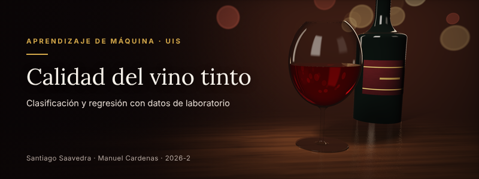

# Proyecto_ML_Calidad_Vino

## Título:

Predicción de la calidad del vino tinto a partir de sus propiedades fisicoquímicas.

## Autores:

Santiago Andres Saavedra Garcia - 2251936, Manuel Esteban Cardenas Hurtado - 2251663

## Objetivo:

Predecir con modelos de aprendizaje de máquina si un vino tinto es de alta calidad (puntaje de 7 o más) y qué puntaje le darían los catadores, a partir de 11 mediciones de laboratorio, e identificar cuáles de esas mediciones pesan más en la calidad.

## Dataset:

Tomado del UCI Machine Learning Repository: Cortez, P., Cerdeira, A., Almeida, F., Matos, T. y Reis, J. (2009). Wine Quality. Link: https://archive.ics.uci.edu/dataset/186/wine+quality

En este repositorio está la copia que usamos: [winequality-red.csv](winequality-red.csv).

El dataset tiene 1.599 vinos tintos portugueses de la variedad *Vinho Verde*. De cada vino se registraron 11 mediciones de laboratorio y el puntaje que le dieron los catadores, de 0 a 10 (en los datos solo aparecen puntajes de 3 a 8). Después de quitar 240 filas repetidas quedan 1.359 vinos distintos, y solo el 13,5 % tiene puntaje de 7 o más.

Las variables que usamos son las siguientes:

- Variables numéricas de entrada: fixed acidity, volatile acidity, citric acid, residual sugar, chlorides, free sulfur dioxide, total sulfur dioxide, density, pH, sulphates, alcohol.
- Variable objetivo para regresión: quality (puntaje de 3 a 8).
- Variable objetivo para clasificación: alta calidad (1 si quality es 7 u 8, 0 en otro caso).

## Modelos:

- Clasificación: Gaussian Naive Bayes, Decision Tree Classifier, Random Forest Classifier, Support Vector Classifier (RBF), Gradient Boosting Classifier.
- Regresión: Linear Regression, Decision Tree Regressor, Random Forest Regressor, Support Vector Regressor (RBF y polinomial).
- Validación y ajuste: Stratified K-Fold, Repeated K-Fold, GridSearchCV, Pipeline con StandardScaler, pesos de clase.
- Interpretación: Permutation Importance, curvas de aprendizaje, ajuste del umbral de decisión.

## Enlaces:

- Código en Notebook de Google Colaboratory: https://colab.research.google.com/github/manuelcardenasu2/Proyecto_ML_Calidad_Vino/blob/main/Proyecto_Calidad_Vino_Tinto.ipynb
- Video: (pendiente)
- Diapositivas: [Diapositivas.pdf](Diapositivas.pdf)
- Repositorio: https://github.com/manuelcardenasu2/Proyecto_ML_Calidad_Vino
